<!-- Generated by assets/pixel.py from an otty-rs checkout. Edit the script, not this file. -->

`$ whoami` Xu Yuanshan (徐元山), M.Eng. student at Harbin Institute of Technology. AI engineering and forward-deployed engineering: I ship LLM gateways, agent plugins and desktop apps end to end. Research: synthetic multimodal data (visible / IR / SAR) in UE5. Stack: Rust, TypeScript, Python, C, Go.

<pre>
$ ls ship/
<a href="https://github.com/BeiZi6/otty-rs">otty-rs</a>               Rust        Otty terminal rebuilt from scratch: Rust engine, Electron UI
<a href="https://github.com/BeiZi6/CSwitch">CSwitch</a>               TypeScript  local Anthropic-compatible gateway for third-party LLM APIs
<a href="https://github.com/BeiZi6/claude-3p-setup">claude-3p-setup</a>       PowerShell  one-command Claude Desktop setup for third-party gateways
<a href="https://github.com/BeiZi6/Ai-Report-Formatter">Ai-Report-Formatter</a>   Python      LLM Markdown to submission-ready Word: equations, citations
<a href="https://github.com/BeiZi6/easy-cc">easy-cc</a>               Markdown    field guide to Claude Code for Chinese developers
<a href="https://github.com/BeiZi6/dsh-opencodego-usage">dsh-opencodego-usage</a>  JavaScript  LLM quota monitor plugin for the DeepSeek Harness web GUI
<a href="https://github.com/BeiZi6/dsh-theme-plugin">dsh-theme-plugin</a>      JavaScript  theme studio plugin for the DeepSeek Harness web GUI
</pre>

`$ cat now` [otty-rs](https://github.com/BeiZi6/otty-rs), the Otty terminal rebuilt from scratch: a Rust engine (VT, PTY, fonts, rasteriser) behind an Electron frontend. 36 of 50 tracked capabilities done, 6 partial, 8 open, as of `81430c2` (2026-10-13). Design notes: [引擎报事件，应用做决定](https://blog.xyucode.top/p/2026-10-06-otty-rs-怎么分层)
